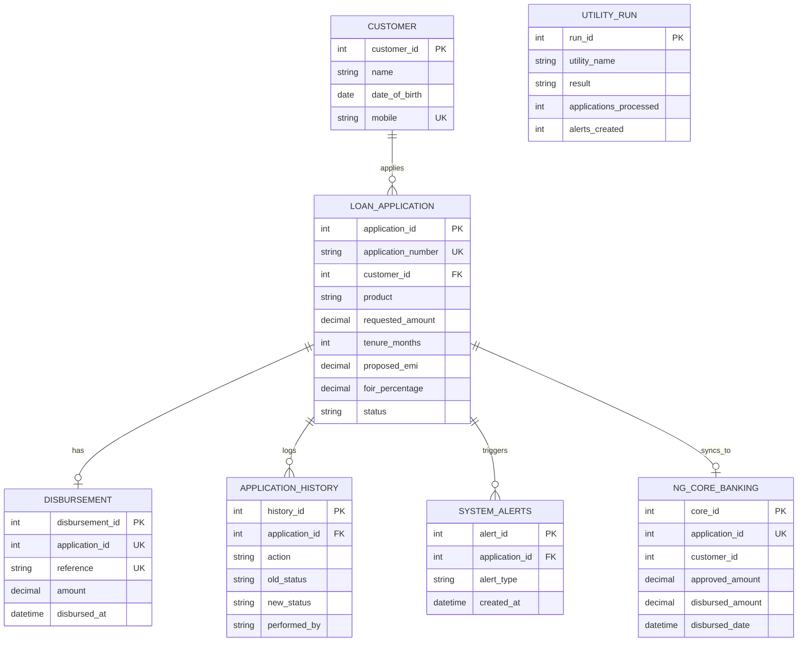

# Mini Loan Origination System - Design Document

## 1. Layered Package Architecture
The application follows a strict 5-layer separation of concerns under src/com/miniloan/:
- console/: Main, MenuController, ConsoleIO, ConsolePrinter, InputClosedException (CLI interface and formatted output)
- service/: ApplicationService, CustomerService, ValidationService, EmiFoirCalculator, ApplicationStateMachine, ApplicationFormGenerator, ReportService, MonitorService, RollbackTestService (business rules, EMI/FOIR math, workflow transitions)
- dao/: TransactionManager, DbConnection, Jdbc, CustomerDao, LoanApplicationDao, DisbursementDao, ApplicationHistoryDao, SystemAlertDao, UtilityRunDao, CoreBankingDao, ReportDao, BranchDao (parameterized JDBC PreparedStatements and transaction rollback)
- model/: Domain entities, enums (ApplicationStatus, Product), DTOs, and domain exceptions
- utility/: UtilityScheduler, OverdueReviewUtility, CoreDataPushUtility, BusinessDateProvider, ConfigLoader, CsvExporter, IndianCurrencyFormatter (scheduled background jobs, CSV export, Indian currency formatting)

## 2. Database Schema & Entity Relationships
Six logical tables + NG_CORE_BANKING:
- CUSTOMER (PK customer_id, name, date_of_birth, UQ mobile [10-digit]) -> 1:N with LOAN_APPLICATION
- LOAN_APPLICATION (PK application_id, UQ application_number, FK customer_id, product, branch_code, branch_name, requested_amount, tenure_months, monthly_income, existing_obligations, annual_interest_rate, proposed_emi, foir_percentage, eligible, eligibility_reasons, status, created_at, submitted_at, decided_at, reviewer_code, decision_reason)
- DISBURSEMENT (PK disbursement_id, UQ application_id [FK], UQ reference, amount, disbursed_at) -> 1:0..1 with LOAN_APPLICATION
- APPLICATION_HISTORY (PK history_id, FK application_id, action, old_status, new_status, performed_by, performed_at, remarks) -> 1:N with LOAN_APPLICATION
- SYSTEM_ALERTS (PK alert_id, FK application_id, alert_type, created_at, UQ [application_id, alert_type]) -> 1:N with LOAN_APPLICATION
- UTILITY_RUN (PK run_id, utility_name, started_at, completed_at, result, applications_processed, alerts_created, error_message)
- NG_CORE_BANKING (PK core_id, UQ application_id, customer_id, customer_name, address, dob, kyc_details, approved_amount, disbursed_amount, disbursed_date)

## 3. State Machine & Integrity Controls
- Normal Flow: DRAFT -> UNDER_REVIEW -> APPROVED -> DISBURSED -> CORE_BANKING_PUSH -> EXIT
- Rejection Paths: DRAFT -> REJECTED (ineligible on submit) or UNDER_REVIEW/APPROVED -> REJECTED (reviewer decision with mandatory reason)
- Terminal States: REJECTED and EXIT (read-only; no further edits or transitions allowed)
- EMI Formula: EMI = P * r * (1 + r)^n / ((1 + r)^n - 1), rounded to 2 decimal places (BigDecimal HALF_UP)
- FOIR Formula: FOIR % = ((existing_obligations + rounded_EMI) / monthly_net_income) * 100 (Eligible when FOIR <= 50%)
- Idempotency & Transactions: TransactionManager enforces full DB rollback on failure; unique constraints prevent duplicate active applications, duplicate disbursements, duplicate overdue alerts, and duplicate core-banking pushes.

## 4. Visual ER Diagram

